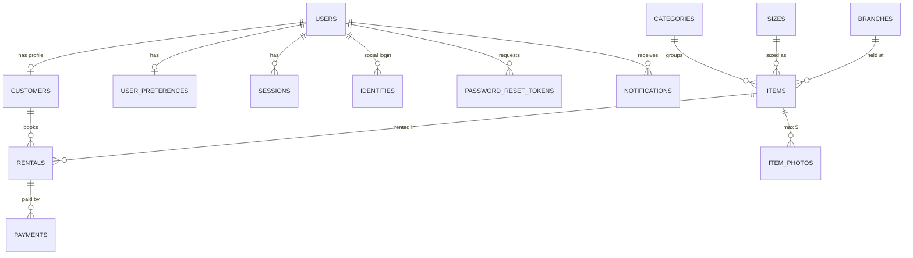

# Simply Design – PostgreSQL database

Database for the Simply Design rental system (admin web + user web). Built from the pages and scripts in
`Simply_Design.zip`. Targets PostgreSQL 15+ (written for 18, the current stable line).

> **Status:** the SQL was checked statically but **could not be executed** where it was written (no
> PostgreSQL server available). Run `99_smoke_test.sql` on your server first – it rolls everything back and
> tells you if anything behaves differently from the design.

## Setup

```bash
psql -U postgres -f 00_init.sql                       # roles + database
psql -U postgres -c "\password sd_api"                # give the backend login a LONG random password
psql -U postgres -d simply_design -f 01_schema.sql    # tables, triggers, views, auth functions
psql -U postgres -d simply_design -f 02_security.sql  # row-level security, grants, audit log
psql -U postgres -d simply_design -f 03_seed_reference.sql   # categories, sizes, branch, settings
psql -U postgres -d simply_design -f 04_seed_demo.sql        # OPTIONAL sample data (not for production)
psql -U postgres -d simply_design -f 99_smoke_test.sql       # should end with ALL TESTS PASSED
```

Create the first admin (hash the password with Argon2id in your backend language, or quickly with
`pip install argon2-cffi`):

```bash
HASH=$(python3 -c "import getpass; from argon2 import PasswordHasher; print(PasswordHasher().hash(getpass.getpass()))")
psql -U postgres -d simply_design -v email='owner@yourdomain.com' -v name='Jun Tabi' -v hash="$HASH" <<'SQL'
SET ROLE sd_owner;
SELECT auth.create_admin_user(:'email', :'name', :'hash');
SQL
```

## What is in the database



| Front-end feature | Where it lives |
|---|---|
| Login / signup / Google & Facebook | `auth.users`, `auth.identities`, functions `auth.create_user`, `auth.get_credentials`, `auth.login_with_identity` |
| Forgot / reset password (30 min, 60 s cooldown) | `auth.create_reset_token`, `auth.consume_reset_token` |
| Inventory (auto codes `LGBLUE0001`, ≤5 photos, Available/Rented/Damaged) | `rental.items`, `rental.item_photos` |
| Catalogue, waistline, "Booked" badge, date picker | `rental.v_catalog`, `rental.item_is_booked`, `rental.item_booked_ranges` |
| Booking + no double booking | `rental.rentals` (exclusion constraint) |
| Rentals page (Active / Returned / Overdue, Paid / Unpaid) | `rental.v_rentals` – overdue and payment status are *derived* |
| Return button, late fee ₱/day | trigger `rentals_before_update` + `business_settings.late_fee_per_day` |
| Customers & Locations pages | `rental.customers`, `rental.v_customer_summary` |
| Dashboard & Analytics | `v_dashboard_stats`, `v_weekly_sales`, `v_monthly_revenue`, `v_inventory_performance` |
| Settings, profile preferences, notifications | `business_settings`, `user_preferences`, `notifications` |

## Security design

Based on current PostgreSQL hardening guidance, the OWASP Password Storage Cheat Sheet, PCI DSS rules on
cardholder data, and the Philippine Data Privacy Act (RA 10173).

1. **Least privilege.** `sd_owner` owns everything and never logs in. The backend connects as `sd_api`
   (member of `sd_app`): not superuser, no DDL, no `BYPASSRLS`, per-statement and idle timeouts. No `DELETE`
   rights on financial tables – records are cancelled / soft-deleted instead.
2. **Credentials are unreachable.** `sd_app` has *no* table privileges on the `auth` schema. It can only call
   audited `SECURITY DEFINER` functions, so even an SQL-injection bug in the API cannot `SELECT password_hash`
   or list reset tokens (it can still call `get_credentials` for a known email – keep the API code tight).
3. **Passwords:** only Argon2id (or bcrypt) hashes are accepted – a `CHECK` rejects anything else, so
   plaintext cannot be stored by mistake. Hash in the backend (OWASP recommends Argon2id). Session tokens and
   reset tokens are stored only as SHA-256 hashes.
4. **Account protection:** 5 failed logins lock the account 15 minutes; `login_attempts` is kept for rate
   limiting; resetting or changing a password revokes all sessions; admins can't be social-login-only and can't
   be linked to Google/Facebook; roles cannot be chosen at sign-up.
5. **Row-level security.** Customers see only their own customer row, rentals, payments, notifications and
   preferences. They can only create a *reserved*, future rental for themselves at the catalogue price with no
   fees. Marking payments paid/refunded is admin/system only. Catalogue and settings: public read, admin write.
   Views use `security_invoker`, so they obey the same rules.
6. **Cards (PCI DSS):** the schema has *no* place for card number, expiry or CVV, by design – storing the
   security code after authorization is prohibited. Keep only provider token/transaction id, brand and last 4.
7. **Integrity:** an exclusion constraint makes double booking impossible even with two simultaneous requests;
   price is snapshotted on each rental; status changes follow `reserved → active → returned | cancelled`.
8. **Audit:** `audit.audit_log` records who changed accounts, customers, items, rentals, payments and settings
   (password hashes stripped) and rejects UPDATE/DELETE/TRUNCATE. The API role cannot even see the schema.

**How the backend must talk to the database** (this is what makes row-level security work):

```sql
BEGIN;
SELECT app.set_context('<user uuid from auth.validate_session>', 'customer');  -- or 'admin'; 'anon' if not logged in
-- ...the request's queries...
COMMIT;
```
Set the context at the start of **every** transaction (it is transaction-local), take the role only from
`auth.validate_session`, never from client input. Caveat: RLS is defence-in-depth against API bugs; an attacker
who runs arbitrary SQL as `sd_api` can call `set_context` too.

## Server hardening (outside the SQL files)

`postgresql.conf`
```
listen_addresses = 'localhost'            # or only the private interface; never 0.0.0.0 on the internet
password_encryption = 'scram-sha-256'     # MD5 password auth is deprecated
ssl = on
ssl_cert_file = 'server.crt'
ssl_key_file  = 'server.key'
ssl_min_protocol_version = 'TLSv1.2'
log_connections = on
log_disconnections = on
log_statement = 'ddl'
```
`pg_hba.conf` (first match wins)
```
local   all            postgres                         peer
hostssl simply_design  sd_api   <APP_SERVER_IP>/32      scram-sha-256
host    all            all      0.0.0.0/0               reject
```
Also: encrypt the disk / volume, encrypted off-site backups (and test a restore), keep PostgreSQL on the latest
minor release (18.x) – PostgreSQL 14 reaches end-of-life on 12 Nov 2026 – and run `SELECT auth.purge_expired();`
daily. Optional: `pgaudit` for statement-level audit.

**Philippine Data Privacy Act:** you hold names, phone numbers and addresses. Keep a privacy notice/consent on
sign-up, collect only what you need, restrict access (done above), and have a breach-response plan – breaches
involving sensitive personal data must be reported to the National Privacy Commission (generally within 72 hours).
Check with the NPC / a lawyer for your exact obligations.

## Changes the front-end needs (the database cannot fix these)

- Accounts, passwords and reset tokens currently live in the browser's `localStorage`, and demo logins
  (admin/user passwords) are hard-coded in the JS. All of that must move to a backend that uses the functions
  above; delete the hard-coded accounts.
- `booking.html` collects card number, expiry and CVV in your own form. Replace it with a payment gateway's hosted
  fields (e.g. PayMongo or Xendit) so card data never touches your server; store only the token.
- Social login uses the OAuth *implicit* flow in the browser; use the authorization-code flow with PKCE on the
  backend and call `auth.login_with_identity` only after verifying the provider's token.
- Upload photos to object storage (JPEG/PNG/WebP, ≤10 MB, re-encoded server-side) and store just the key in
  `item_photos` – not base64 images.
- `settings.html` and `contact.js` show different business phone/email; pick one and update `business_settings`.

## Not included (ask if you want them)
TOTP two-factor storage (the profile's 2FA toggle is a demo in the front-end), multi-branch admin screens,
payment-gateway webhook handlers, partitioning of the audit log.
